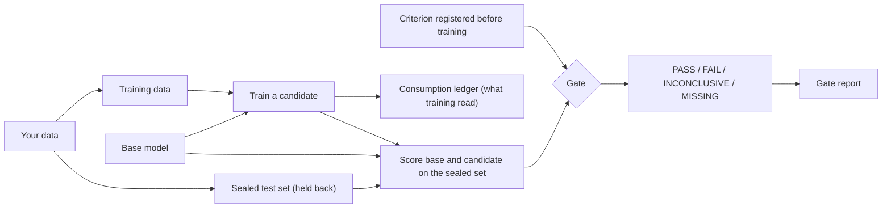

# gatedtrain

gatedtrain checks whether a newly trained model checkpoint is really better than (or, if you choose, no worse than) the model it started from. It
calls the new checkpoint better only when it beats a criterion you registered before training, on held-out test
data the trainer never saw. It also records what went into each training run, so that you can later ask which
checkpoints may have used a given piece of training data, for example after finding a problem in it.

It is for people who fine-tune models and want a decision they can defend, made by rules that were fixed before
the results came in. It works with external trainers and evaluators.

This is a prototype. Reports and records of the demo and of external runs carry the tags `prototype` and
`unpromotable`, which mark them as not fit for promoting a model. AI-native projects are a preview.

## How it works

You fix the test before training. You train while a ledger records which data was read, then score the old and the
new model on held-out test data, and a gate gives one of four results in a report.



- The **registration** fixes the criterion before training: the metric, the margin to beat and how sure the test
  must be. The spec records the registration file's SHA-256 hash; `validate` and `run` refuse if the file no longer
  matches.
- The **sealed test set** is the evaluation data, kept apart from the training data. How strictly this is enforced
  depends on how you use gatedtrain; see
  [Concepts](https://github.com/gatedtrain/gatedtrain/blob/main/docs/concepts.md#sealed-test-set).
- The **gate** compares the two models item by item. Only PASS means the candidate met the registered rule.
- The **consumption ledger** records which training data each run read, so the `impact` command can trace data to
  checkpoints.

Each idea is explained in [Concepts](https://github.com/gatedtrain/gatedtrain/blob/main/docs/concepts.md).

## Try it

The demo trains a very small model on two-digit addition, on a CPU. From a checkout with Python 3.12 or 3.13:

```sh
python -m venv .venv
. .venv/bin/activate
python -m pip install -e '.[tier-a]'          # the tier-a extra installs PyTorch
gatedtrain validate demo/spec.yaml            # checks the spec and its registration; prints "ok"
```

Then run it from the repository root, with a fresh `demo/baseline` path:

```sh
gatedtrain warmup demo/warmup.yaml --out demo/baseline    # trains the starting (base) model
gatedtrain run demo/spec.yaml --runs-root demo/runs       # trains a candidate, scores both, prints the gate report
gatedtrain impact demo/data/train/shard-00003.jsonl --runs-root demo/runs   # which checkpoints may have used this shard
```

`run` prints its output directory and the gate report. The
[CPU quickstart](https://github.com/gatedtrain/gatedtrain/blob/main/docs/quickstart.md) explains each line of the
report and shows control runs that FAIL or come out INCONCLUSIVE on purpose.

## No sudo

The AI-native keeper runs without sudo by default: `gatedtrain setup keeper` prints user-level commands for a keeper
under your own OS user (same-user mode), and `gatedtrain setup check` names the outside prerequisites and changes nothing: gatedtrain itself needs no sudo, but rootless
Docker and its prerequisites (uidmap, subuid ranges, the NVIDIA CDI spec) may need an administrator once on a machine that lacks them. Same-user mode follows the procedure but does not seal the data from your account, and
every result says so on its first line:

```text
keeper mode: same-user (NOT sealed from the user's account: the procedure is followed, the sealed data is not protected from anything running as the user; to harden: gatedtrain setup keeper --mode separate-user)
```

To harden, run the keeper under its own OS user (`gatedtrain setup keeper --mode separate-user`, one sudo). See the
[quickstart without sudo](https://github.com/gatedtrain/gatedtrain/blob/main/docs/sudo-free-quickstart.md) and
[Keeper modes](https://github.com/gatedtrain/gatedtrain/blob/main/docs/ai-native.md#keeper-modes).

## Three ways to use it

| Way | What it is | Read |
|---|---|---|
| The CPU demo | A small model on two-digit addition, trained and gated on a laptop. The quickest way to see a gate report. | [Quickstart](https://github.com/gatedtrain/gatedtrain/blob/main/docs/quickstart.md) |
| External training runs | You train with your own framework (for example TRL or NeMo RL) on your GPU. A recipe repository's adapter reads the run's outputs, and `ext-collect` gates them. gatedtrain does not start the training itself. | [External runs](https://github.com/gatedtrain/gatedtrain/blob/main/docs/external-runs.md) |
| AI-native projects (preview) | `gatedtrain project` runs one goal through fixed stages and seals part of your data for the test itself. On Linux, a keeper (a service) signs every record. By default it runs under your own OS user: it follows the procedure, but nothing is sealed from your account. Under its own OS user (hardened) it also holds the sealed data out of your account's reach. | [AI-native projects](https://github.com/gatedtrain/gatedtrain/blob/main/docs/ai-native.md) |

## Learn more

The guides below are also published as a website: <https://gatedtrain.github.io/gatedtrain/>.

- [Concepts](https://github.com/gatedtrain/gatedtrain/blob/main/docs/concepts.md): registration, sealed test set,
  gate results, alpha spending, the consumption ledger and `impact`
- [Commands](https://github.com/gatedtrain/gatedtrain/blob/main/docs/commands.md): every subcommand
- [External runs](https://github.com/gatedtrain/gatedtrain/blob/main/docs/external-runs.md): adapter plugins and
  recipe repositories
- [AI-native projects](https://github.com/gatedtrain/gatedtrain/blob/main/docs/ai-native.md): the keeper and its two
  modes, rootless containers and scenario packs, with their guarantees and limits
- [Quickstart without sudo](https://github.com/gatedtrain/gatedtrain/blob/main/docs/sudo-free-quickstart.md): the
  prerequisites, `setup check`, the same-user keeper and how to harden it
- [NeMo RL on a rootless host](https://github.com/gatedtrain/gatedtrain/blob/main/docs/rootless-nemo-rl.md): lessons
  from the first runs
- [Configuration](https://github.com/gatedtrain/gatedtrain/blob/main/docs/configuration.md): the host file and
  environment variables
- [Development](https://github.com/gatedtrain/gatedtrain/blob/main/docs/development.md): tests and design references
- [Tier B runbook](https://github.com/gatedtrain/gatedtrain/blob/main/docs/tier-b-runbook.md): a GPU run with NeMo RL
- [Changelog](https://github.com/gatedtrain/gatedtrain/blob/main/CHANGELOG.md)

## Data and licenses

- GSM8K (`openai/gsm8k`, MIT, © 2021 OpenAI): downloaded by `export-gsm8k` at a pinned dataset commit. The fixtures
  under `tests/fixtures/tierb/` are synthetic rows in GSM8K's shape; `tests/fixtures/r11/longrun/raw_samples.json`
  quotes one GSM8K test question (see `THIRD_PARTY_NOTICES.md`).
- NeMo RL and NeMo Evaluator (Apache-2.0): used unchanged as external tools at pinned commits (NeMo RL `4f39fd8`,
  NeMo Evaluator `ea35ba3`); the NeMo RL container image is built from NeMo RL's own Dockerfile
  (`containers/nemo-rl-uid1000/README.md`). gatedtrain quotes NeMo Evaluator's GSM8K prompt text so that training
  and evaluation prompts agree (see `THIRD_PARTY_NOTICES.md`).
- Qwen3-0.6B (Apache-2.0, Qwen team): the base model of the Tier B run; downloaded by the operator, not
  redistributed (a few of its responses are quoted in `raw_samples.json`).
- Checkpoints: the external-run commands hash model files and read safetensors headers and JSON; they never unpickle
  a checkpoint. The Tier A stand-in model loads its own checkpoint with `torch.load(..., weights_only=True)`; load
  only checkpoints you produced.

## License

gatedtrain is licensed under the Apache License, Version 2.0 (`LICENSE`). See `NOTICE` for the copyright notice and
`THIRD_PARTY_NOTICES.md` for the third-party material it includes.

Names of third-party projects and products are trademarks of their owners; gatedtrain is not affiliated with or
endorsed by them.
