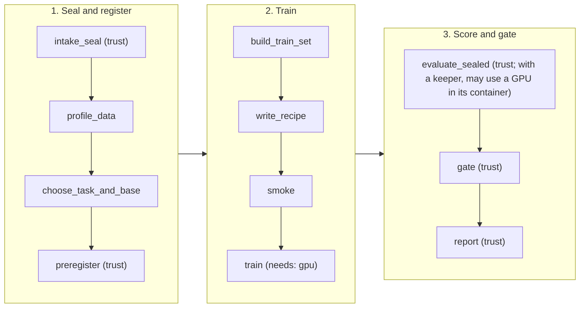
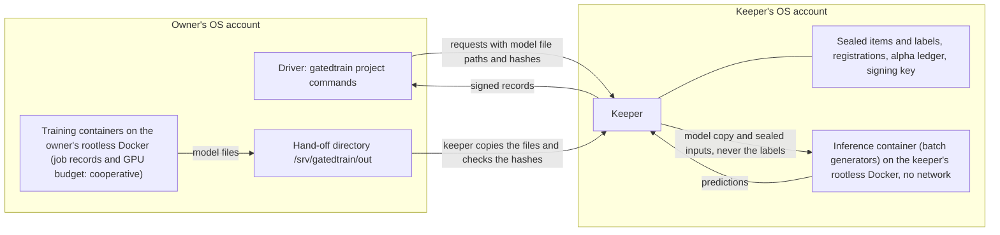

# AI-native projects (preview)

This page is for people who want gatedtrain to run a whole training goal as one project, from labelled data to a
gate report. It covers the `gatedtrain project` commands, the keeper that holds the sealed test data (in
[one of two modes](#keeper-modes): under your own OS user, the default, whose setup commands need no sudo (rootless Docker and its prerequisites may need an administrator once; `gatedtrain setup check` names them), or under its own OS user,
the hardened mode), the rootless containers that run the jobs, and scenario packs. It is a preview: the guarantees and limits
below are stated exactly, and the quoted texts are the ones the reports print. New to the ideas? Read
[Concepts](concepts.md) first.

The preview grew in steps, and the page uses their names: step 1 runs every stage in your own process, step 2 adds
the keeper, and step 3a adds rootless containers. These steps are not pipeline stages.

## How a project runs

`gatedtrain project` runs one goal as a project directory: a fixed pipeline of five trust stages (`intake_seal`,
`preregister`, `evaluate_sealed`, `gate`, `report`) around the stages a pipeline file plugs in. The trust stages are
gatedtrain's own: they seal the data, register the criterion, score, gate and report, and their names are reserved,
so a pack cannot replace them. Step 1 is a preview for CPU-only work and the synthetic scenario pack in
`gatedtrain.testing`, which is not registered as an entry point.

The synthetic scenario pack's pipeline runs in three phases: seal and register (`intake_seal`, `profile_data`,
`choose_task_and_base`, `preregister`), train (`build_train_set`, `write_recipe`, `smoke`, `train`), then score and
gate (`evaluate_sealed`, `gate`, `report`). The stages marked "trust" are gatedtrain's; the others are the pack's
stages, named in the pipeline file. The backend gives GPU jobs only to a stage that declares `needs: gpu` (here
`train`, which the example pack declares as needing a GPU but runs on the CPU; a cooperative rule, see
[What is cooperative](#what-is-cooperative)), and with a keeper, a batch generator
scores in the keeper's container, on a GPU when it asks for one.



```sh
gatedtrain project create ./proj --goal "..." --data labelled.jsonl --pipeline pipeline.yaml [--gpu-hours H]
gatedtrain project plan ./proj <stage>                       # what a stage would do; changes nothing
gatedtrain project run ./proj <stage> [--decision file.json] # stages run in pipeline order
gatedtrain project status ./proj
gatedtrain project report ./proj
```

`--pipeline` is the path of a pipeline YAML. `--gpu-hours` is recorded in `project.yaml` as the budget; step 1
enforces nothing. `run` of the `gate` stage exits 0 on PASS and 1 otherwise; a refusal exits 3. Re-running a stage
with unchanged inputs returns its recorded result. A top-level `--json` prints one result object per call.

`project create` copies the pipeline into `<root>/pipeline.yaml` and records its sha256; the project refuses a copy
that was changed. To use another pipeline, create a new project. A stage that refuses in `run` before it writes any
record, spends alpha or claims a trust record is logged as `refused` and changes no stage state; a refusal after any
of these, or from the output checks, is `failed`.

## Without a keeper (step 1)

In step 1 every stage runs in your own process. The rules:

- Without a keeper (step 1, in process), a project scores its sealed items once: after the first scoring
  `evaluate_sealed` refuses to score again, for the same model reference too (a rerun with unchanged inputs returns
  the recorded scores).
- A model reference must content-address its weights (for example carry their hash); step 1 does not check this, so
  a reference to a mutable checkpoint path lets the gate records describe weights the reference no longer points to
  after a retrain.
- The gate spends the project's single alpha: a second gate attempt is refused. A project bound to a keeper follows
  the keeper's alpha rule instead (below).

**Trust boundary in step 1.** Stages run in the operator's process. CLI outputs carry only hashes of the sealed
items, but in step 1 they sit in plain files under `<root>/trust/` that the operator and any stage can read and
rewrite, as can the attempt log; the report's `sealed_guarantee` says so ("unsealed (step 1): the operator process
can read the sealed items, and every stage can read and rewrite the trust records and the attempt log").
A project bound to a keeper (below) moves these records out of the operator's reach. In step 1 the alpha is per
project: a new project on the same data would get a fresh alpha and the same sealed split, so a new test needs new
sealed data. The report's known limits list these points, the model-reference rule, that the metric confirmation is
the decision flag `metric_confirmed` set by whoever runs the stages, and how many `evaluate_sealed` attempts the
project made.

## The keeper (step 2)

The keeper is a daemon (Linux only: a Unix socket with a peer-credential check). It alone holds the sealed items, the
registrations, the claims, the per-item records, the alpha ledger and an Ed25519 signing key; the stages of a bound
project become requests to it, and it signs every record it returns. Only the owner's uid and its own may connect.
What the keeper can promise depends on which OS user it runs as, so the page starts with the two modes and then says
how to set up each.

### Keeper modes

A keeper runs in one of two modes. The mode is an observed fact, not an option: nothing you pass on a command line, in
an environment variable or in a project file can state it.

- **Same-user mode (the default).** The keeper runs under your own OS user. Its setup commands need no sudo (rootless Docker and its prerequisites may need an administrator once; `gatedtrain setup check` names them). The keeper follows
  the procedure (it signs the registration before training, spends alpha before it scores, and runs a batch generator's
  model in a container without network access and without the labels; a per-item generator runs inside the keeper process
  without that confinement), but nothing is sealed from your account: anything running as you, such as an
  agent with a shell, can read the sealed items, the labels, the alpha ledger and the signing key. Its reports show
  that the procedure was followed, not that the sealed data stayed unseen.
  Batch packs need the keeper to be started with `--inference-image` (`gatedtrain setup keeper --inference-image
  sha256:...`) and a rootless Docker of your user in this mode too; without it the keeper refuses a batch generator
  (AN-8).
- **Separate-user mode (hardened).** The keeper runs under its own OS user, with a 0700 state directory and a
  root-owned environment, and you have no rootful Docker access. Setting it up takes one sudo. It is the mode the
  rest of this page's guarantee text describes.

What each mode guarantees:

| Property | Separate-user | Same-user |
|---|---|---|
| The agent's shell cannot read the sealed items and labels | Yes (0700 state of another uid; [Rootful access](#rootful-access) guards the rootful Docker route) | **No**: the state directory is the user's own |
| The alpha ledger cannot be reset or edited | Yes | **No** |
| Records cannot be forged | Yes (the signing key is the keeper's) | **No**: the key is readable, so any record can be re-signed |
| The keeper's code cannot be changed by the agent | Yes (root-owned environment, AN-13) | **No**: the code is the user's |
| The registration is recorded before training | Yes | Yes against an agent that follows the interface; forgeable by one that reads the key |
| Alpha is spent before scoring and every attempt is in the report | Yes | Yes for everything that goes through the keeper's interface; an agent can bypass the interface |
| A batch generator's model runs in a container with no network, a read-only root and no labels | Yes | Yes (the same boundary; an escape yields the user's account, which already holds everything in this mode) |
| A per-item generator's model runs inside the keeper process (no container, no network confinement) | Yes (the keeper's own account) | Yes (the user's account) |
| Model files are copied and hashed by the keeper; executable formats are refused | Yes | Yes |
| `keeper confirm` is typed by a human | No (owner uid, see [Setting up](#setting-up-and-binding-a-project)) | No |
| The original data file stays readable to you | Stated limit | Stated limit |

In short: in same-user mode the gate protects against accident, drift and an agent that follows the interface. It does
not protect against an agent that opens the files, which is the case the keeper was built for, so a same-user result is
weaker evidence for "the model improved" and every surface says so.

**How the mode is observed.** The keeper and the client each read it from the kernel and the file system, and the
verifier uses the weaker answer:

- *The keeper* is in separate-user mode only when all of these hold: its effective uid is not the owner uid it serves,
  its state directory belongs to its own uid and is closed to group and others, and the peer of the connection is not
  the keeper's own uid (rule AN-27). Any failed condition gives same-user mode. The last condition catches a process
  the agent starts as `keeper serve --owner-uid <another number>`: the agent reaches it as a peer with the keeper's own
  uid, so that peer sees same-user mode whatever `--owner-uid` says. `--owner-uid` only names who may connect.
- *The client* (the driver and `verify`) asks the kernel for the credentials of the process that listens on the socket
  (`SO_PEERCRED` on its own connected socket). It believes "separate-user" only when the keeper claims it and the
  listener's uid differs from the client's own. A keeper that claims separate-user mode while the kernel says the
  listener has the client's own uid is refused (rule AN-29, exit 3): that socket is served by a process of your own
  uid, not by the keeper you were bound to. Where the kernel's answer is unavailable (anything but Linux) the claim
  never upgrades the result: the effective mode is same-user, noted as "kernel attestation unavailable".
- *The records* carry the mode: the keeper's signed environment record, every registration, claim and report, and
  `hello` (`keeper_mode`, `mode_facts`, `modes_seen`; the older `same_user` flag stays and equals
  `keeper_mode == "same_user"`). A report has `schema_version` 3 with `keeper_mode`, `modes_seen`, a `keeper_mode` on
  each attempt and `require_keeper_mode`; `verify` still accepts version 2 reports and reads their mode from the signed
  guarantee text.
- *The mode is sticky and only gets weaker.* The keeper records every mode it served a sealed set in. Once a set was
  served in same-user mode it stays same-user, so a restart under a stronger observation never upgrades it. A set
  served in both modes says so in its report, and its effective mode is the weaker one.
- *`verify` folds in every statement.* The effective mode is the weakest of the keeper's claim (checked against the
  kernel), the `keeper_mode` of every signed registration and claim receipt, and each report's mode, `modes_seen` and
  per-attempt modes. A report that states a stronger mode than a receipt it covers, or whose `modes_seen` or attempts
  contradict the receipts, or that leaves out an attempt's mode, is refused (AN-14). `keeper_mode` in the output is that
  effective mode; the keeper's raw claim is only `mode_sources.keeper_claim`. When the project holds keeper receipts but
  no source states a mode, `verify` says "mode unknown" and exits 1 (receipts written before keeper modes state none: verify with `--keeper`, or with `--fingerprint` once a report states the mode; and a registration that requires `separate_user`
  is refused, AN-28).
- *Limits of the statement.* The kernel check (AN-29) holds for the reader's own account and the account that owns the
  project files (the owner of the project directory and of `trust/keeper.json`, read without following links): a
  listener with either uid that claims separate-user mode is refused, because whoever wrote the records can run a keeper
  of its own with a key it holds. A reader under a third account (an admin, CI) must anchor with a fingerprint taken from
  the real keeper. Offline (`--fingerprint` or no anchor) `separate-user` means "stated by the key holder": on a
  same-user keeper the key holder is the user's own account, so a signed `separate_user` can be forged by the very
  account the mode is meant to guard against, and a fingerprint kept away from the agent does not change that (the key
  is readable by the user). Every such result carries the warning "the mode is as stated by the holder of the key", its
  text says `mode as stated in the signed records: <mode>` and the JSON data has `mode_basis`: `kernel_attestation`
  (the keeper is the anchor and the kernel answered), `signed_records` (receipts or a signed `keeper_mode`) or
  `report_text` (only the text of a version 2 report). Only `--keeper`, against a keeper whose state is out of the
  owner's reach, makes the statement an observation. `keeper fingerprint` prints this limit.

Every surface prints the mode line. For a same-user keeper it reads `keeper mode: same-user (NOT sealed from the
user's account: the procedure is followed, the sealed data is not protected from anything running as the user; to
harden: gatedtrain setup keeper --mode separate-user)`; for a separate-user keeper, `keeper mode: separate-user (the
sealed data and the signing key are held by another OS user)`. The line appears in `keeper fingerprint` (with a
`harden:` line in same-user mode), in `project create --keeper` before any data is taken in, in the output of the
`intake` stage, in `keeper confirm` before the sentence you confirm, at the top of a report's `report.md` (whose headline
adds "(same-user keeper: procedure followed; sealed data not protected from the user's account)" to a PASS), in
`project report` and in `verify`. Quote it in any summary of a result.

**Requiring the hardened mode.** `gatedtrain project create ... --require-keeper-mode separate-user` (default `any`)
records, in the keeper and in the signed registration, that this project accepts a separate-user keeper only. It is
fixed when the project is opened: opening it again with another value is refused. A same-user keeper refuses it at
`project create` (nothing is stored); a keeper whose set was ever served in same-user mode refuses `evaluate_sealed` and
`gate`; and `verify` exits 3 on a result whose evidence shows same-user, also under `--accept-mode`. All of these are
rule AN-28.

**What `verify` returns by mode.** Exit 0 only for a separate-user result: the anchor and the kernel agree (with
`--keeper`) or the signed report says so (with `--fingerprint`), no rootful access is flagged, and the report states
the separate-user text. A same-user result exits 1 with a warning that names the mode, unless you pass `--accept-mode
same-user`: then exactly that result, and no other weaker one (a rootful-access, revision 23 or unknown text still
exits 1), exits 0, starts with `accepted (weaker mode): ...` and ends with `ACCEPTED WEAKER MODE: same-user (procedure followed;
sealed data not protected from the user's account)`, with `accepted_weaker_mode: true` in the JSON data. The option is per call: no
environment variable or project file sets it. In the JSON data `verify` gives `keeper_mode`, `effective_mode` and
`mode_basis` and `mode_sources` (`keeper_claim`, `kernel_attestation`, `report` and `receipts`); the exit-0 text names the
mode in one line. A project whose records state no mode and that has no report says "the records carry no keeper mode
(written before 0.7.0) and no report states one" and exits 1. A report whose `keeper_mode` is not a mode
or contradicts the guarantee text it signs is refused (AN-14, exit 3).

**Mixing and migrating.** No state moves between keepers.

- A project is bound to one keeper key. To change modes, run a second keeper (its own state directory, socket and key)
  and create new projects bound to it. Both can run on one host on different sockets; their fingerprints tell them
  apart.
- *Same-user to separate-user (hardening):* a new keeper, a new key, new data intake. Treat the old sealed items as
  exposed, since the agent could read them. Old projects keep verifying with `verify --fingerprint <fp>` and report
  same-user. Never copy the old key or state into the new keeper.
- *Separate-user to same-user:* only by starting a new same-user keeper; never import a separate-user keeper's state
  into a user-owned directory, which would silently destroy its guarantee.
- The keeper refuses to start on a state directory that does not belong to its own uid, so one state is not served in
  both modes by a restart; only a hand-made `chown` could do that, and then the set records both modes and is
  same-user.

Rules: AN-27 to AN-29 (see the [test reference](../tests/README.md)).

### The two accounts of separate-user mode

The picture shows the two OS accounts of separate-user mode once the keeper and the rootless containers of step 3a are
set up (in same-user mode both boxes are your account). Your (the owner's) account runs the driver and the training containers. The keeper's account holds the sealed items and
labels, the registrations, the alpha ledger and the signing key, and runs the inference container for batch
generators (a per-item generator runs the candidate inside the keeper process instead). Model files and their
hashes go in; signed records come out; the inference container gets the sealed inputs, never the labels. The
job records and the GPU budget on your side are cooperative (see [What is cooperative](#what-is-cooperative)), and
the keeper still answers some questions with counts (see [Oracles](#oracles)).



The [Guarantee](#guarantee) below says exactly what this separation covers and what it does not ("a root user, also
one reached through sudo, or the keeper's own account can break all of it"); while your account has rootful Docker
access, or for good on a sealed set that was in use when such access was found, the keeper states a weaker text instead (see [Rootful access](#rootful-access)).

### Setting up and binding a project

Same-user mode, the default, needs no sudo:

```sh
gatedtrain setup check                                  # names the outside prerequisites; changes nothing
gatedtrain setup keeper                                 # prints user-level commands; runs nothing
# run the printed commands, then:
gatedtrain keeper fingerprint --socket "$XDG_RUNTIME_DIR/gatedtrain-keeper/keeper.sock"   # keep it out of band
gatedtrain project create ./proj --goal "..." --data labelled.jsonl --pipeline pipeline.yaml \
    --keeper "$XDG_RUNTIME_DIR/gatedtrain-keeper/keeper.sock"
gatedtrain keeper confirm ./proj --decision preregister.json [--yes]          # before `run ./proj preregister`
gatedtrain verify ./proj --keeper "$XDG_RUNTIME_DIR/gatedtrain-keeper/keeper.sock"    # or --fingerprint sha256:...
```

The [quickstart without sudo](sudo-free-quickstart.md) walks through it. The separate-user setup:

```sh
gatedtrain setup keeper --mode separate-user [--user NAME] [--owner-uid UID] [--packages NAME==VERSION ...]   # prints sudo commands; runs nothing
gatedtrain keeper fingerprint --socket /run/gatedtrain-keeper/keeper.sock
gatedtrain project create ./proj --goal "..." --data labelled.jsonl --pipeline pipeline.yaml \
    --keeper /run/gatedtrain-keeper/keeper.sock [--require-keeper-mode separate-user]
```

- `setup keeper` (same-user) prints commands that create the state directory
  (`${XDG_DATA_HOME:-~/.local/share}/gatedtrain-keeper`, mode 0700), a systemd *user* unit
  (`~/.config/systemd/user/gatedtrain-keeper.service`, or under `$XDG_CONFIG_HOME`) that runs `gatedtrain keeper serve`
  from the current Python environment (so the scenario packs installed there are the keeper's packs; `--packages` is
  ignored), and the fingerprint check. The socket is `$XDG_RUNTIME_DIR/gatedtrain-keeper/keeper.sock`, with
  `/run/user/<uid>` when the variable is unset. It starts with the line `# same-user mode: no sudo; run these as YOUR user, not with sudo. The keeper runs
  under your own OS user, so it does NOT seal data from your account (an agent with your shell can read it). To
  harden: gatedtrain setup keeper --mode separate-user (one sudo).` and writes nothing; with no systemd user session
  it prints the `keeper serve` command to run in a terminal. `loginctl enable-linger`, which may ask an administrator,
  is offered as an optional comment so that the keeper survives logout, and `systemctl --user restart
  gatedtrain-keeper.service` as a comment to apply changed options to a unit that is already running. An empty value for
  `--state`, `--socket`, `--user` or `--venv` is refused in both modes. `--user` and `--venv` belong to separate-user
  mode and are refused here (AN-30); `--state` and `--socket` are allowed. Rules: AN-30, AN-31.
- `setup keeper --mode separate-user` prints the commands that create the keeper user, its 0700 state directory, a
  root-owned virtual environment with gatedtrain and the scenario packs pinned to versions, and a systemd unit running
  `gatedtrain keeper serve`; it writes nothing. This is the output `setup keeper` gave before the default changed.
- `setup check` names the outside prerequisites (rootless Docker, `uidmap`, subordinate ids, user namespaces,
  rootless networking, and with a GPU the NVIDIA driver and CDI spec); see the [quickstart](sudo-free-quickstart.md).
  Rules: AN-32, AN-33.
- The keeper refuses to start when its code, environment, state directory or socket directory can be changed by
  another user; a path holding `%`, `$`, whitespace, a quote or a backslash is refused by `setup keeper`, since
  systemd would rewrite it in the unit. Known limit of that check: a module first imported after the start-up check
  that lies outside gatedtrain, the installed scenario packs and gatedtrain's runtime dependencies is not checked, and
  site-packages is not walked as a whole. A same-user keeper passes the same check, since the owner's own files are
  allowed there.
- `project create --keeper` binds the project to the key the keeper serves (`trust/keeper.json`,
  `trust/keeper.pub`) and prints the mode line; a bound project never falls back to step 1: an unreachable keeper or
  one serving another key is refused. With `--require-keeper-mode separate-user` it refuses a same-user keeper first.
- `keeper confirm` shows the mode line and the sentence that says what the scorer counts and the margin, and records
  it in the keeper only after you type `yes` (or pass `--yes`; under `--json` it never prompts); it needs a terminal
  or `--yes`, and an agent must not run it. `preregister` refuses a registration without a matching confirmation.
- The scorer comes from the library (`exact_match`, `numeric_match`, `normalised_match`, `set_f1`, `field_f1`) or
  from a pack by reference.

### Alpha rule

In short: every attempt on a sealed set spends part of one shared budget before scoring, a PASS earns some back,
and a report closes the set. The exact rule:

Under the keeper the alpha is not per project but per sealed set, by alpha-investing (Foster-Stine): the initial
wealth is W0 = 0.05 * (1 - 0.05) = 0.0475; attempt j bids alpha_j = W_{j-1} / 2 (at most W_{j-1} / (1 + W_{j-1}),
so a bid never costs more than the wealth; this binds only above a wealth of 1); a FAIL, INCONCLUSIVE, MISSING or
crashed attempt costs alpha_j / (1 - alpha_j); a PASS earns the payout 0.05; an attempt whose bid would be below
0.005 is refused. Intake plans power at W0 / 2 = 0.02375. Each `evaluate_sealed` spends its alpha before any item is
scored, so a project may gate several candidates (rerun `train`, then `evaluate_sealed` and `gate`) until one
passes; a PASS ends the project's attempts. A new project on byte-identical data shares the sealed set and its
wealth; other data holding a sealed item are refused. The report lists every attempt with its alpha, cost and payout
and states the guarantee: "alpha-investing (Foster-Stine) over the gate attempts on this sealed set controls the
marginal false discovery rate (mFDR) at level 0.05". Its known limits qualify this: it assumes each test is valid
given the earlier outcomes; the sealed items are reused across attempts and only each attempt's status is revealed.
A report closes the sealed set: no further attempt on it, from any project, and a new project on the same data is
refused at intake.

### Oracles

The keeper answers some requests about sealed data with counts and does not limit how often they are asked: opening
a project is free and a refused intake stores nothing, so anything running as the user can learn from intake
refusals how many inputs of a candidate data file were sealed before (and, repeated, which); a registration refused
for its scorer names how many sealed labels that scorer cannot take. The report lists this in its known limits.

### Guarantee

The texts below are the ones a report prints, and each states the mode that produced it. A keeper never words a weaker
mode with the text of a stronger one.

With the keeper in separate-user mode, the report's `sealed_guarantee` reads: "the sealed items, registrations, claims,
ledger and per-item records are held by a separate OS user running code the user's account cannot change, and every
record is signed; the keeper found no rootful Docker or containerd access by the user's account, nor the account in
the docker, lxd, incus-admin or disk group, when this was stated or at any earlier check on this sealed set (sudo is
not checked); a scenario pack's per-item generator runs the candidate inside the keeper process, and a batch
generator runs it in a container of the keeper's own rootless Docker with no network, a read-only root file system and
the predictions as its only output; either way the candidate is a copy of the model files the keeper hashed, and a
model format that executes code is refused; an escape from that container through a bug in the inference code or the
kernel gives the keeper's account; the original data file and the metric confirmation are only as strong as the
user's own account; a root user, also one reached through sudo, or the keeper's own account can break all of it."

A keeper in same-user mode states, whatever the rootful-access check says: "the keeper ran under the same OS user as
the owner (same-user mode). It followed the procedure: the registration was signed before training, every sealed
attempt spent its alpha before it was scored, and a batch generator's model ran in a container without network access
that was given the inputs only, never the labels (a per-item generator runs inside the keeper process, without that
confinement). It does not protect the sealed items, the labels, the alpha ledger or its signing key from anything
running as that user, such as an agent with a shell, so these records show that the procedure was followed, not that
the sealed data stayed unseen. Run the keeper under a separate OS user (`gatedtrain setup keeper --mode separate-user`,
one sudo) for that guarantee."

Reports signed before this text existed carry the earlier same-user text, "the keeper runs as the owner's own OS user,
so anything running as the user can read its state and signing key: the records are signed, but nothing is sealed (a
test or development setup)". `verify` still recognises it and warns exactly as for the new one; no keeper states it
any more.

### Checking the records: `verify`

`verify` checks the project's signed records against the keeper's key.

- `verify ./proj --keeper SOCKET` checks every signed record in the project (the registration, each receipt in
  `trust/keeper/records.jsonl`, the gate result, `report.json` and `report.md`) against the key the keeper serves,
  and that the project holds every record the keeper signed for it; `--fingerprint` checks against a fingerprint
  held out of band, offline, and cannot detect a deleted record (it says so).
- It exits 0 when every record checks and the result is a separate-user one (see [Keeper modes](#keeper-modes)), 3 on
  a bad signature, an edited record, a replaced `trust/keeper.pub`, another fingerprint, a keeper that claims
  separate-user mode while the kernel says its listener has your own uid (AN-29), a report whose mode contradicts its
  signed text (AN-14), or a project whose registration requires a separate-user keeper while the evidence shows
  same-user mode (AN-28), and 1 without either anchor, against a same-user keeper or a report that states the same-user
  mode (consistency only: the owner can read that keeper's key), and also, under any anchor, when a report states any
  guarantee but the separate-user one above (the same-user texts, the downgraded text of the rootful-access check
  below, or the 0.4.0 text), with a warning naming it. `--accept-mode same-user` turns exactly the same-user result
  into exit 0 and says so; `verify` also prints a warning for a trainer image a report flags as user-added, and
  `--require-maintainer-images` makes that exit 1 (see [Trainer images in the report](#trainer-images-in-the-report)).
- The driver keeps every envelope the keeper signed for the project: after each `evaluate_sealed`, `gate` and
  `report`, and on `project report`, it fetches the keeper's list and adds what it lacks (for example the claim of an
  evaluation it stopped waiting for), each verified first. A record the keeper signed that the project still lacks
  fails `verify --keeper` with exit 3.

Rules: AN-12 to AN-14, AN-16 to AN-18, AN-27 to AN-29 (see the [test reference](../tests/README.md)).

## Rootless containers, the local backend and the keeper's container (step 3a)

Step 3a runs a project's jobs and the keeper's sealed evaluations in containers on rootless Docker (preview, Linux
only). The owner and the keeper each run their own rootless Docker daemon, and the owner leaves the rootful `docker`
group, through which anything running as the owner could otherwise read the keeper's state.

The host script and the group removal belong to the hardened [separate-user mode](#keeper-modes); a same-user keeper needs
no root step, only the outside prerequisites that `gatedtrain setup check` names.

```sh
gatedtrain setup host [--inference-image REF@sha256:...] [--eval-requirements FILE --eval-python PATH] \
    [--confirm-group-removal]                     # prints one root script; runs and writes nothing
sudo bash gatedtrain-host-setup.sh                # after reading it; delete it afterwards
gatedtrain project job list ./proj                # also: job logs ./proj JOB_ID [--tail N], job cancel ./proj JOB_ID
```

### Host

`setup host` prints one bash script for root.

- **Checks first.** All its checks come before its first change: it runs as root, the owner has the uid it was
  printed for, an NVIDIA CDI specification of `nvidia.com/gpu` exists in `/etc/cdi` or `/var/run/cdi`,
  `slirp4netns` or `pasta` is installed, no subordinate id range of the owner or the keeper user covers the other's
  uid or gid, and the parents of the directories it creates are root-owned and not writable by others.
- **Then the changes.** It then installs `uidmap` and `docker-ce-rootless-extras` at the installed `docker-ce`
  version, adds the AppArmor profile rootlesskit needs on Ubuntu 24.04, creates the keeper user (as `setup keeper --mode separate-user`)
  and the subordinate id ranges, removes the owner from the `docker` group before any of the owner's user services
  start (`--confirm-group-removal` pauses first), enables lingering, starts one rootless daemon per user with its own
  data root (`/srv/gatedtrain/docker` for the owner, `/var/lib/gatedtrain-keeper-docker` for the keeper) and
  Docker's native CDI, and creates the owner's Docker context `gatedtrain`.
- **Hand-off directory.** Jobs write the models the keeper reads under the hand-off directory `/srv/gatedtrain/out`
  (the owner's, mode 0755).
- **Options.** With `--inference-image` the keeper's daemon pulls that image and a drop-in of the keeper's systemd
  unit starts `keeper serve` with its image ID; with `--eval-requirements` (hash-pinned, binary wheels only) the
  script builds a root-owned eval environment (`/opt/gatedtrain-keeper/eval-venv`) from an interpreter under
  `/opt/gatedtrain-keeper/python`, mounted read-only into the keeper's containers.
- **Afterwards.** A login session keeps the `docker` group until it ends, so log out everywhere afterwards; when the
  owner's user manager was already running (the script warns), restart it once those sessions have ended (`sudo
  systemctl restart user@<uid>.service`, or reboot), since the owner's rootless daemon started under it with the
  group.

Then set in the host file (see [Configuration](configuration.md)):

```toml
rootless = true
output_root = "/srv/gatedtrain/out"
```

### Local backend

Pack stages start their jobs through the local backend; the jobs run as containers on your rootless daemon.

- **What a stage can call.** A pack stage reaches the project's job backend as `ctx.backend`:
  `new_output_dir(name, key=...)`, `submit(job)`, `status`, `wait`, `logs`, `cancel`, `artifacts` and `hand_off`.
- **How a job starts.** A `Job` (an image pinned by digest, the argv, read-only input mounts, one output directory,
  environment names the adapter allows, GPU or not, a time limit and a GPU-hour estimate) is checked by the launch
  rules `ext-launch` applies to a request of its adapter before anything starts, and runs detached on the owner's
  rootless daemon (the context `gatedtrain`). The backend refuses a daemon that is not rootless or whose socket is
  not the owner's, and an image the daemon does not hold (no job pulls one). Each attempt writes into a fresh
  `<output dir>/a<n>`.
- **Records.** The project keeps the records under `<root>/jobs/`: the job (environment names only), one row per
  attempt start, end, stop and cancel, and the tail of each attempt's log. Every job that ends adds one row to
  `<host_work>/gpu-log.md` ([gpu-step.md](gpu-step.md)).
- **Retries and limits.** `failed`, `preempted` and `lost` attempts are retried up to `max_attempts` (default 3);
  `oom`, `timed_out` and `cancelled` ones are not. A GPU attempt waits up to 900 s for a free GPU and is refused when
  the project's committed GPU-hours plus its estimate pass the budget (`--gpu-hours`); a running attempt is stopped
  at its time limit or at the budget.
- **After a crash.** A stage run again with unchanged inputs gets the same job, so after the driver died while a job
  ran, `project run <stage>` reattaches to the running container instead of starting another one.
- **Hand-off.** `hand_off(job_id, paths)` returns `{path, sha256}` for model files the keeper user can read (regular
  files with `o+r`, directories with `o+x`, no link on the way), the `files` of a model reference.

### The keeper's container

`keeper serve --inference-image sha256:<64 hex> [--eval-tree DIR ...] [--docker-host URL] [--docker PATH]
[--nvidia-smi PATH]` runs a scenario pack's batch generator in a container of the keeper's own rootless daemon, one
container per arm for all registered seeds, with `--user 0:0 --cap-drop ALL --security-opt no-new-privileges
--read-only --network none --log-driver none` and Docker's default seccomp profile. Before any alpha is spent the
keeper copies the model files a reference lists into its own state and checks their hashes; the container gets only
that copy, read-only at `/in/model`, and the sealed inputs (never the labels) in a file. Its `/out` must then hold
exactly one well-formed `predictions.jsonl`; anything else is a crash, and the attempt has spent its alpha. The
report's `compute` block states the keeper's containers and their seconds from the keeper's signed records, and the
backend's job totals the driver sends with the report request, marked "the driver's job records (cooperative, not
checked by the keeper)".

### Trainer images and the image lock

gatedtrain names a container image by a logical name (`nemo-rl/tierb`, `nemo-rl/tierb-uid1000`,
`nemo-rl/tierb-rootless`) and keeps the accepted image IDs as data, in an image lock shipped with the release, not in
code. Each entry records the recipe the image was built from, its Containerfile hash, its base image and its origin
(`maintainer-built`). The owner can add the ID of an image they built themselves in one file of their own,
`$XDG_CONFIG_HOME/gatedtrain/images.json` (`~/.config/gatedtrain/images.json` by default); those entries have origin
`user-built`. The file can only add IDs to logical images the lock already names. It is read without following links
and must be a regular file owned by you that group and others cannot write; a file that is not is refused, not
ignored. The file cannot name an ID the lock lists. Limit: your environment (`HOME`, `XDG_CONFIG_HOME`) decides where the
file is, and an agent running as you controls both, so it can run `image add --yes` or write the file itself: the owner
config is NOT a security boundary against a same-user agent. The reliable signal is the keeper's `user_added` flag in
the signed report (below), which holds when the keeper's code is outside the agent's reach (a separate-user keeper).

```sh
gatedtrain image list                                    # every accepted image, its origin and recipe
gatedtrain image check nemo-rl/tierb-rootless --ref IMAGE_REF [--docker-context CTX]    # or --id sha256:...; exit 0 if accepted, 1 if not
gatedtrain image add nemo-rl/tierb-rootless --id sha256:... --recipe NAME --recipe-commit COMMIT \
    [--containerfile-sha256 sha256:...] [--base-id sha256:...] [--built-utc YYYY-MM-DD] [--note TEXT] [--yes]
```

`image check` prints the exact `image add` command for an image that is not accepted. `image add` records the image in
your config as an explicit act: it asks you to type `yes` at a terminal (or takes `--yes`), prints that the report will
flag the image as not in the maintainer lock, and only adds; there is no remove command, the file is yours. It is
recorded for provenance only: published packs read the shipped lock, so it changes nothing for gating until packs adopt
`accepted_images(logical)`. The build
recipes are under `containers/` in the source repository, which is not shipped in the wheel or sdist, so they need a
source checkout (see [NeMo RL on a rootless host](rootless-nemo-rl.md)). `--built-utc` must be a real date; two
`image add` runs at once keep both entries (an advisory lock beside the file); a file nested too deeply for JSON is
refused like any malformed file. Rules: IMG-1 to IMG-6.

#### Trainer images in the report

The driver reads the image ID of each job record and declares, for each distinct trainer image, its logical name,
origin and recipe. The keeper does not take that declaration on trust: it checks each ID against its own copy of the
shipped lock, which lies in code the user's account cannot change in separate-user mode. For an ID the lock lists, the
keeper fills in the logical name, origin and recipe from its own lock (`declared_by: keeper`), whatever the
driver sent; for any other ID it flags it `user_added` and keeps only a declaration that cannot contradict that
(`declared_by: driver`): `source: owner_config`, origin `user-built`, a logical name and a recipe, else the image is
shown as `unlisted` with no name, origin or recipe, so a driver cannot get `maintainer-built` or `source: lock` signed
next to `user_added` (a driver whose lock is newer than the keeper's shows its image as unlisted); a repeated ID is
refused (IMG-8). It also signs the sha256 of the lock bytes it checked (`images_lock_sha256`). `report.md` has one line per image,
`trainer image <logical>: <origin> <id> built from recipe <name> <commit> (in the maintainer lock: the keeper recognises
this ID | USER-ADDED, not in the maintainer lock; the driver declares that jobs ran in it)`, then the limit line "not
observed: job records are the driver's ...": the keeper recognises an ID, it never saw which image ran. `verify` prints
the lock hash and the same limit line (the hash is informational until release hashes are published; in same-user mode
the lock file is writable by you) and `trainer image <id> is user-added (not in the maintainer lock)` for each flagged image; with
`--require-maintainer-images` it exits 1 on one. A report whose jobs have no image block (an older driver, or one that
left it out) makes `verify` warn "no image provenance stated ... trainer images not declared by the driver". With
`--require-maintainer-images` a report must list at least one image and every listed image must be in the keeper's lock,
else it exits 1 ("images not declared"): a report with no backend totals, zero jobs or an empty list states nothing, so
it fails the flag, and so does a project with no report at all ("no report states any trainer image"; without the flag a
report that ran no jobs is silent). A report whose image entries are malformed or
contradict themselves is refused (AN-14, exit 3), never rendered. A new driver against a keeper that predates images
retries the report once without them and warns "the keeper does not know trainer image provenance"; that warning and
the "job records cannot be read" one are in the command's `--json` `warnings`, not only on stderr. Limit: the job records the driver reads are in the
agent-writable project, so the block is the driver's declaration of the images, not proof of what ran; it says which
image the driver reports and whether the maintainers listed it. Rules: IMG-7 to IMG-9.

### Rootful access

At every `hello`, intake, sealed summary, evaluate, gate and report request the keeper checks whether the owner's
account can reach a rootful Docker or containerd daemon: membership of `docker`, `lxd`, `incus-admin` or `disk` or of
a rootful socket's group, a process of an old session that still carries such a group, a rootful socket writable by
everyone or carrying an access control list, a listener on TCP port 2375 or 2376. A check it cannot complete counts
as positive, and so does a process table it cannot fully see (`/proc` mounted with `hidepid`, or no PID 1 and no
process of another user). `keeper fingerprint` shows `owner_has_root_docker` and the reasons. While the check is
positive, and for good on every sealed set in use at a positive check, a separate-user keeper states instead: "the
keeper runs as a separate OS user, but the user's account can reach a rootful Docker or containerd daemon or holds a
root-equivalent group (docker, lxd, incus-admin or disk), or did at a check while this sealed set was in use, and
through that can read the keeper's state and signing key: the records are signed, but nothing is sealed from the
user's account; remove the user from those groups, end the sessions that still carry them, and take in new data".
`verify` exits 1 against a keeper whose `hello` says `owner_has_root_docker`, and on a report that states any text
but the separate-user guarantee.

### What is cooperative

The job records, the GPU budget, the GPU log and the `ctx.backend` rules (a GPU job only from a stage that declares
`needs: gpu`, no job and no output directory from `plan`) hold for drivers and stages that use the backend: anything
running as the owner can start containers on the owner's daemon itself or edit the project's records. The budget is
enforced while a driver polls the job. `rootless = true` is the host file's word: the backend checks the daemon it
reaches, while `ext-launch` only prints. The keeper's own container time is the checked figure, and the
rootful-access check does not cover sudo.

Rules: AN-9, AN-22 to AN-24, IMG-1 to IMG-9 (see the [test reference](../tests/README.md)).

## Scenario packs

A scenario pack is a distribution that registers its stages in the entry point group `gatedtrain.stages` (one class
per stage name; the five trust stage names are reserved) and one object in `gatedtrain.scenarios` with `name`,
`generators` (per-item generation functions, by the name a model reference gives in `generator`), `pipeline` (the
pipeline file), `scorers` (by reference) and `batch_generators` (`gatedtrain.ainative.batch.BatchGenerator`
declarations, by name). A name is either a per-item or a batch generator. A pack that has only batch generators still
exposes an empty `generators` mapping. A per-item generator runs inside the keeper process; a batch generator runs
only in the keeper's inference container (the in-process path and a keeper started without `--inference-image`
refuse it). `gatedtrain.testing.synthetic_pack` is a small example of both (`synthetic_pack.yaml`,
`synthetic_pack_batch.yaml`); it is not registered as an entry point.

A `BatchGenerator` names its `script` (an absolute path inside the pack's installed package), the `interpreter` that
runs it (an absolute container path: the image's own, or one inside the keeper's eval trees with `eval_trees=True`),
`gpu` and `time_limit_s` (default 1200). The keeper runs `<interpreter> -I /gen/<script> --items /in/items.jsonl
--sampler /in/sampler.json --model /in/model --out /out`. The script reads one `{"item_id", "input"}` line per item
and `{"sampler", "seeds"}`, and writes only `/out/predictions.jsonl`: one line `{"item_id", "prediction", "seed"}`
per item and seed, each written as `json.dumps(doc, sort_keys=True, separators=(",", ":"), ensure_ascii=False,
allow_nan=False)` followed by a newline. That is the keeper's canonical form only when `prediction` is a str, an int
within ±(2**53-1), a bool or null: a float, a larger int, a missing, extra or duplicate line, or any other file in
`/out` is a crash.

Rules: AN-8, AN-9 (see the [test reference](../tests/README.md)).

### Greedy decoding

A scenario pack's deployment record may register greedy decoding instead of sampling. It is an explicit opt-in, never
a side effect of `temperature: 0`:

```json
{"sampler": {"name": "greedy", "decoding": "greedy", "temperature": 0, "max_new_tokens": 512},
 "eval_seeds": [11]}
```

- `decoding: greedy` needs `temperature` exactly 0, a `top_p` that is absent or 1.0, and **one** evaluation seed (one
  sample per item). `temperature: 0` without `decoding: greedy`, `decoding: greedy` with another temperature, and
  several seeds are refused (`REG-GREEDY`). Everywhere else (`ext-*`, Tier B, `check_contents` without
  `greedy_allowed`) greedy decoding stays refused: nothing there can check the arms.
- The statistics are unchanged. The item is the resampled unit and a per-item score is the mean of its repeats, so
  one sample per item gives an interval over items, `n` is the number of items, and the planning SD (the 0/1 bound)
  already covers the larger per-item variance of a single deterministic output. A greedy score estimates the greedy
  decoder's accuracy; it is not comparable with a score at temperature 0.7.
- **Control seed (AN-26).** The keeper does not take "greedy" from the pack. Each arm's container call carries the
  registered seed and one more seed that the registration does not name, drawn per attempt and placed in random order;
  the keeper compares the two sets of predictions itself, and scores only the registered seed's. Any difference
  refuses the attempt (`AN-26`, counts only), settles it as not passed and costs its alpha, like a crash (AN-9): the
  comparison is one bit about the sealed items. A repeat under the same seed would not do, since seeded sampling
  repeats too.
- A pack whose vLLM run is not repeatable fails closed (see the known limits in the [changelog](../CHANGELOG.md#changes-in-060): with default batching 54 to 56 % of the items differed for Qwen3.5-0.8B, `max_num_seqs=1` gave none). Making it so (a fixed batch order, no prefix caching, eager
  mode, one process) is the pack's job and is not checked beyond this comparison. The control pass runs in the same
  process, so cross-process differences are not seen.
- The scenario pack's generator must accept `decoding` in its sampler (a script that refuses unknown sampler keys
  needs the key added) and must ignore the seed.

Rules: REG-GREEDY, AN-26.
