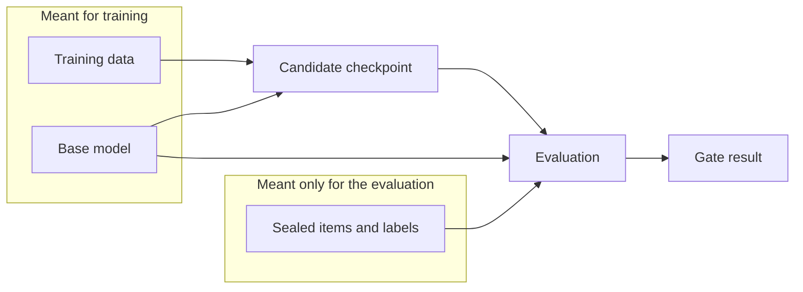
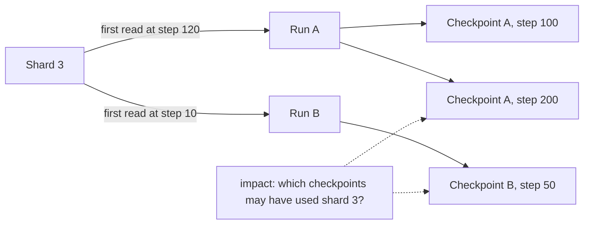

# Concepts

This page explains the main ideas of gatedtrain in plain words. Each section is short; the linked pages hold the
details. gatedtrain is a prototype, and every output carries the tags `prototype` and `unpromotable`.

A few words used throughout:

- A **checkpoint** is a saved copy of a model's weights. The **base** is the model you start from; the
  **candidate** is the checkpoint that training produces from it.
- A **shard** is one file of training data, for example `demo/data/train/shard-00003.jsonl`.
- A **spec** is the YAML file that describes a run: the base model, the training data, the trainer, the evaluation
  data, the evaluator and the registration.
- An **item** is one test question (with its expected answer) in the evaluation data.

## Registration

A registration is a YAML file that you write **before** training. It fixes how the candidate will be judged:

- the metric (for example exact match) and whether higher or lower is better;
- the kind of test: superiority (the candidate is better), non-inferiority (it is not worse by more than a margin) or
  equivalence (it is within a margin either way);
- the margin, the alpha (see [Alpha spending](#alpha-spending)) and the target power (how likely the test should be to
  detect a real improvement of the planned size);
- the evaluation seeds and how many times each item is scored;
- the evaluator, by its hash.

The spec names the registration together with its SHA-256 hash. A run refuses to start when the file's hash no longer
matches, so the criterion cannot be changed quietly after the fact. A registration may be amended, but an amendment
made after results of the candidate existed is marked `post_hoc`, and a PASS under it is reported as INCONCLUSIVE.

In the CPU demo the registration is not signed, and the report says `registration: unsigned`. In an AI-native project
bound to a keeper, the keeper stores the registration and signs it (see
[AI-native projects](ai-native.md#the-keeper-step-2)).

## Sealed test set

The sealed test set is the evaluation data: the items both models are scored on. It is kept apart from training, so
that a good score cannot come from having seen the answers.

The picture shows what each side is meant to see: training uses the training data and the base model; only the
evaluation reads the sealed items and their labels (by design; how strictly this is enforced is below).

How strongly the separation is enforced depends on how you use gatedtrain:

- **CPU demo.** The evaluation prompts are in their own directory (`demo/data/heldout`), and the spec declares them
  disjoint from the training data. The demo does not check this: the report says `disjoint_from: not-assessed
  (skeleton)`.
- **External runs.** `ext-collect` refuses when an evaluation item's text exactly equals a training row's (or, for
  adapters that log their training episodes, a logged training episode's), unless the registration allows the
  overlap (`contamination: {allow_exact_overlap: true}`). Some adapters add their own overlap rules, which refuse
  whatever the registration allows.
- **AI-native projects.** gatedtrain makes the split itself. The first stage, `intake_seal`, removes duplicate inputs,
  seals a part of the data for evaluation and passes on only the training part, the sealed part's hash and size, and
  a few summary numbers. Without a keeper the sealed items still sit in plain files that your own account can read;
  the report says so. With a keeper they are held by a separate OS user. The exact guarantees and limits are in
  [AI-native projects](ai-native.md).

## Gate results

The gate scores the base and the candidate on the same sealed items, several times each with the registered seeds.
For each item it takes the difference between the two models' scores, then computes a confidence interval for the
average difference. It compares that interval with the registered margin. The result is one of four:

| Result | Meaning |
|---|---|
| PASS | The candidate meets the registered criterion: the interval clears the margin. |
| FAIL | The records match the registration, the test has enough power, and the candidate does not meet the criterion. |
| INCONCLUSIVE | The data cannot decide: too few paired items, an interval of zero width (for example identical models), a test without enough power that did not pass, or a registration changed after the results (`post_hoc`). |
| MISSING | The evaluation records do not match the registration: too many items or repeats missing, wrong seeds, malformed or unknown records, or a model or evaluator hash that differs from the registered one. |

Only PASS opens a blocking gate. An underpowered test that passes is still PASS, with an `underpowered` flag; an
underpowered test that does not pass is INCONCLUSIVE, never FAIL. When a gate has several criteria, any FAIL makes
the whole gate FAIL; otherwise any MISSING makes it MISSING, then any INCONCLUSIVE makes it INCONCLUSIVE, and it is
PASS only when every criterion passes. The report also gives the reason for a MISSING or INCONCLUSIVE result
(`status_reasons`). The [CPU quickstart](quickstart.md#3-reading-a-gate-report) explains every line of the report.

## Alpha spending

Alpha is the chance of a false PASS that the test accepts: a PASS for a candidate that is not really better by the
margin. The demo registers alpha = 0.025. Each time a gate looks at the same sealed set, there is another chance of a
lucky PASS, so repeated attempts must share a budget, or the guarantee no longer holds. Using up part of that budget
is called spending alpha.

- **CPU demo and external runs.** Each run's gate uses the alpha of its registration. gatedtrain does not count
  attempts across runs; the report says `family_alpha: not-assessed (skeleton)`.
- **AI-native projects without a keeper.** The project has one alpha, and its gate spends it: a second gate attempt is
  refused. A new project on the same data would get a fresh alpha and the same sealed split, so a new test needs new
  sealed data.
- **AI-native projects with a keeper.** The budget belongs to the sealed set, not to the project, and follows
  alpha-investing (Foster-Stine): each attempt spends part of the budget before any item is scored, a PASS earns some
  back, and an attempt whose share would be too small is refused. A report closes the sealed set to further attempts.
  The numbers and the exact guarantee are in [AI-native projects](ai-native.md#the-keeper-step-2).

## The consumption ledger and impact

The consumption ledger records which training data each training step read. The lineage next to it records which
checkpoints each run saved and the last step each one includes. `run`, `tierb-collect` and `ext-collect` write both
into the run directory.

`gatedtrain impact <shard>` uses them to answer one question: which checkpoints may have used this shard? It finds
the first step that read the shard and returns every checkpoint of that training stage saved at or after that step.
A checkpoint saved before the shard was first read is not returned, and neither is the base model.

In the picture, shard 3 was first read at step 120 of run A and at step 10 of run B, so `impact` returns A's
step-200 checkpoint and B's step-50 checkpoint, but not A's step-100 checkpoint.

Each answer states its precision: `row` when the exact rows each step read are known, `iteration` when only the
shards each step read are known (the CPU demo), or `stage` when only the fact that the training stage used the
dataset is known (then every checkpoint of the stage is returned). Only a `row` answer says "consumed"; the others
say "possibly consumed". `--runs-root` searches every run under a directory. More in the
[CPU quickstart](quickstart.md#2-first-run) and [Commands](commands.md).

## Other terms

- **Recipe repository.** A separate repository for one training task (for example TRL GRPO on GSM8K). It holds the
  adapter, a small plugin that reads that trainer's outputs, and the instructions to run it. See
  [External runs](external-runs.md#recipe-repositories).
- **Keeper.** A service under its own OS user (Linux only) that holds the sealed items, the registrations and the
  alpha budget of AI-native projects, and signs every record it returns. See
  [AI-native projects](ai-native.md#the-keeper-step-2).
- **Scenario pack.** A Python package that adds the stages, scorers and generators of one kind of AI-native project.
  See [AI-native projects](ai-native.md#scenario-packs).
