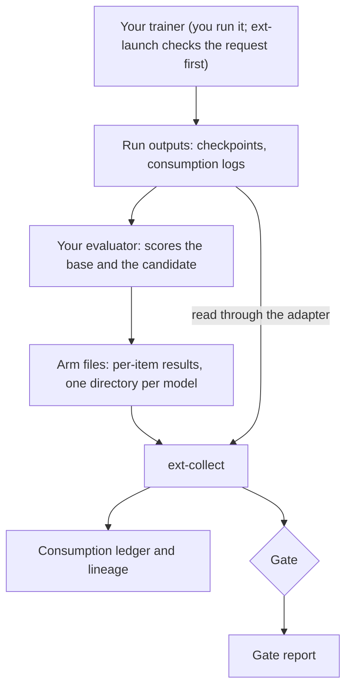

# External runs

This page is for people who train with their own framework (for example TRL or NeMo RL) and want gatedtrain to
gate the result. gatedtrain does not start the training: you run your trainer and your evaluator, and gatedtrain
reads what they wrote. The page shows the flow, then the adapter plugins that read each trainer's outputs and the
recipe repositories that ship ready-made adapters.

## How an external run flows

The picture shows the flow: `ext-launch` checks your run request and prints the command; you run your trainer and
your evaluator; the evaluation results of the base and the candidate become one arm directory each; `ext-collect`
reads the run's outputs through the adapter, compares the two arms and writes the consumption ledger, the checkpoint
lineage and the gate report.



1. `ext-launch` checks the run request, writes the launch record and prints the command; you run it.
2. Your evaluator scores the base and the candidate on the registered items. Its results become one arm directory
   per model (`items.jsonl` and `eval_meta.json`); `ext-from-nel`, `ext-merge-eval` and `ext-arm-fill` build and
   verify these.
3. `ext-collect` compares the two arms item by item and writes the run directory: gate report, consumption ledger
   and checkpoint lineage. `impact` then works on it.

Every command and its flags: [Commands](commands.md) and section 7 of the
[CPU quickstart](quickstart.md#7-external-runs-adapters-gpu-run-by-an-operator). How `ext-collect` checks that the
evaluation items were not in the training data: [Concepts](concepts.md#sealed-test-set).

## Adapter plugins

An adapter is how gatedtrain understands one trainer's outputs. Each external training recipe has an adapter: a
pure-Python class that reads the run's outputs (checkpoints, consumption logs, evaluation records) without importing
the training framework, plus registry rows that describe the run (inputs, container paths, pins, evaluators). A
recipe package registers them through the Python entry point group `gatedtrain.adapters`:

```toml
[project.entry-points."gatedtrain.adapters"]
my_adapter = "my_recipe.my_adapter_rows:PLUGIN"
```

where `PLUGIN = {"adapters": {name: "module:Class"}, "trainer_rows": {name: row}, "evaluator_rows": {id: row}}`
(`gatedtrain.ext.registry`). Adapters use the helpers of `gatedtrain.ext.sdk` and `gatedtrain.ext.rowkit`.

### Conformance kit

A recipe repository can run the conformance checks with its own tests, so that a plugin that
registers but would break `ext-launch`, `ext-arm-fill` or `ext-collect` fails before any GPU run:

```python
import unittest
from gatedtrain.ext.conformance import AdapterConformance

class TestConformance(AdapterConformance, unittest.TestCase):
    ADAPTER = "my_adapter"
```

`gatedtrain.testing` provides the shared test helpers (canonical JSON and manifest hashes, CLI subprocess runs) and a
synthetic adapter, `gatedtrain.testing.synthetic`: a complete, small example of the adapter interface that
gatedtrain's own tests run on. It is registered only when a test asks for it (`install()` in process, or
`python -m gatedtrain.testing.synthetic <gatedtrain arguments>` for a CLI run), never by an installed distribution.

## Recipe repositories

Each recipe ships its own adapter and runtime instructions.

| Task | Recipe |
|---|---|
| Math reasoning | [TRL GRPO on GSM8K](https://github.com/gatedtrain/gatedtrain-recipe-trl-grpo-gsm8k) |
| Drone control | [Stable-Baselines3 PPO](https://github.com/gatedtrain/gatedtrain-recipe-sb3-ppo-drone-hover) |
| Image generation | [DDPO with SD1.5](https://github.com/gatedtrain/gatedtrain-recipe-ddpo-sd15) |
| Image generation for OCR | [Flow-GRPO with SD3.5](https://github.com/gatedtrain/gatedtrain-recipe-flow-grpo-sd35-ocr) |
| Video generation | [Flow-GRPO with Wan](https://github.com/gatedtrain/gatedtrain-recipe-flow-grpo-wan-video) |
| Speech recognition | [Whisper SFT on AMI](https://github.com/gatedtrain/gatedtrain-recipe-whisper-sft-ami) |
| Text-to-speech | [CosyVoice DPO](https://github.com/gatedtrain/gatedtrain-recipe-cosyvoice-dpo-tts) |
| CAD | [NeMo RL for CAD](https://github.com/gatedtrain/gatedtrain-recipe-nemo-rl-cad) |
| Visual reasoning | [NeMo RL on CLEVR](https://github.com/gatedtrain/gatedtrain-recipe-nemo-rl-vlm-clevr) |
| Robot manipulation | [LeRobot SmolVLA on LIBERO](https://github.com/gatedtrain/gatedtrain-recipe-lerobot-smolvla-libero) |
| Agentic math | [NeMo RL for agentic math](https://github.com/gatedtrain/gatedtrain-recipe-nemo-rl-agentic-math) |
